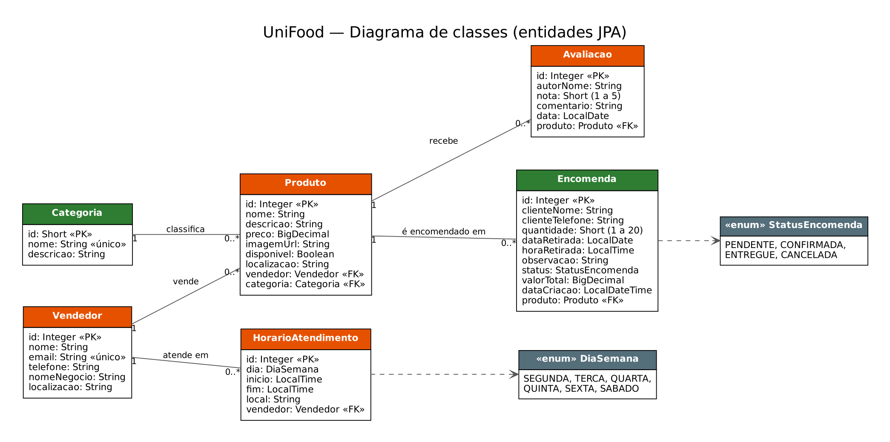

# UniFood — Backend
## Integrantes

| Nome completo | RA |
|---|---|
| Isabelly Giovana Batista da Silva | 273258 |
| Isabella Fernanda Camargo da Cruz | 273608 |
| Vitória Teixeira Salgado | 273885 |
 
Backend do **UniFood**, o catálogo de comidas vendidas por alunos dentro da faculdade
## Descrição

No UniFood, quem vende cadastra seus produtos e informa os dias, horários e locais em que atende no campus. Quem compra consulta o catálogo, avalia os produtos e faz **encomendas** para retirar com o vendedor em um dos horários de atendimento. O vendedor acompanha tudo por um **painel** com os indicadores do negócio.

## Finalidade do backend

Substituir o armazenamento no navegador do front-end Angular ([projeto-integrador-iv-five.vercel.app](https://projeto-integrador-iv-five.vercel.app)) por uma API com banco de dados MySQL, regras de negócio no servidor, validação dos dados e controle de acesso por perfil.

Partiu do projeto de e-commerce do professor (mesma estrutura de pastas e pacotes: `entidades`, `repositorios`, `recursos`), adaptado ao domínio do UniFood e ampliado com as camadas de serviço, exceções e segurança.

## Tecnologias

- Java 21
- Spring Boot 4.1 (Web MVC, Data JPA, Validation, Security)
- Hibernate / JPA
- MySQL 8
- Lombok
- Maven (wrapper incluso)
- JUnit 5 (testes de repositório e de serviço)
- Postman (testes manuais da API)
- Dev Container (VS Code + Docker) com JDK 21, Maven e MySQL

## Modelo de dados

6 entidades: **Categoria**, **Vendedor**, **Produto**, **Avaliacao**, **HorarioAtendimento** e **Encomenda**.



| Relacionamento | Multiplicidade |
|---|---|
| Vendedor — Produto | 1 para 0..* |
| Vendedor — HorarioAtendimento | 1 para 0..* |
| Categoria — Produto | 1 para 0..* |
| Produto — Avaliacao | 1 para 0..* |
| Produto — Encomenda | 1 para 0..* |

Em relação ao front-end, entraram duas entidades:
- **Categoria**: organiza o catálogo por tipo de comida (Doces, Salgados, Refeições, ...).
- **Encomenda**: permite reservar um produto para retirada, em vez de só combinar pelo WhatsApp. É a funcionalidade específica do PI.

## Estrutura

```
.
├── README.md
├── .devcontainer/                  ambiente pronto (JDK 21, Maven, MySQL)
├── docs/
│   ├── modelo-dados.png            diagrama de classes
│   ├── modelo-dados.dot            fonte do diagrama (Graphviz)
│   └── documentacao-api.md         documentação dos endpoints
├── postman/
│   └── projeto-integrador.postman_collection.json
└── unifood/                        projeto Spring Boot
    ├── pom.xml
    └── src/
        ├── main/java/br/edu/unifio/unifood/
        │   ├── entidades/          entidades JPA e enums
        │   ├── repositorios/       Spring Data JPA (consultas personalizadas)
        │   ├── servicos/           regras de negócio
        │   ├── recursos/           endpoints REST
        │   ├── excecoes/           exceções personalizadas e @RestControllerAdvice
        │   ├── dtos/               corpo de erro e painel do vendedor
        │   └── configuracoes/      Spring Security
        ├── main/resources/
        │   ├── application.properties
        │   └── import.sql          dados iniciais
        └── test/java/...           testes de repositórios e serviços
```

Os recursos (controllers) só chamam serviços; o acesso ao banco fica sempre nos serviços.

## Como executar

### Opção 1 — Dev Container (recomendado)

1. Abra a pasta no VS Code com a extensão **Dev Containers** e escolha **Reopen in Container**.
2. O container instala o MySQL e cria o banco `unifood` com o usuário `unifood` / `123@Mudar`.
3. No terminal:
   ```bash
   cd unifood
   ./mvnw spring-boot:run
   ```

### Opção 2 — Na sua máquina

Requisitos: JDK 21 e MySQL 8 rodando na porta 3306.

1. Crie o usuário do banco (ou mude usuário e senha em `unifood/src/main/resources/application.properties`):
   ```sql
   CREATE USER IF NOT EXISTS 'unifood'@'%' IDENTIFIED BY '123@Mudar';
   GRANT ALL PRIVILEGES ON unifood.* TO 'unifood'@'%';
   FLUSH PRIVILEGES;
   ```
2. Rode:
   ```bash
   cd unifood
   ./mvnw spring-boot:run        # Windows: mvnw.cmd spring-boot:run
   ```

A API sobe em `http://localhost:8080`. O banco é **recriado a cada execução** (`ddl-auto=create`) e recebe os dados do `import.sql`.

Teste rápido:
```bash
curl -u cliente:cliente123 http://localhost:8080/produtos/disponiveis
```

### Testes automatizados

Com o MySQL rodando:
```bash
cd unifood
./mvnw test
```

## Segurança

HTTP Basic com usuários em memória (somente para testes desta atividade):

| Usuário | Senha | Perfil |
|---|---|---|
| `admin` | `admin123` | ADMIN |
| `vendedor` | `vendedor123` | VENDEDOR |
| `cliente` | `cliente123` | CLIENTE |

- Todas as rotas exigem login → sem credenciais ou com senha errada: **401**.
- Exemplos de **403**: `cliente` criando produto, `vendedor` criando categoria, `cliente` vendo o painel do vendedor.

A tabela completa de permissões está em [docs/documentacao-api.md](docs/documentacao-api.md).

## Regras de negócio (camada de serviço)

- E-mail do vendedor e nome da categoria são únicos.
- O vendedor não pode ter horários de atendimento sobrepostos no mesmo dia.
- Encomenda só para produto disponível e dentro de um horário de atendimento do vendedor (não há atendimento aos domingos).
- Valor da encomenda calculado pelo servidor (preço × quantidade).
- Fluxo da encomenda: PENDENTE → CONFIRMADA → ENTREGUE, com cancelamento antes da entrega; só encomendas pendentes podem ser editadas.
- Não é possível excluir categoria com produtos, nem produto ou vendedor com encomendas em aberto.
- Produto sem localização usa a localização do vendedor.

## Testes no Postman

1. Importe `postman/projeto-integrador.postman_collection.json`.
2. Suba a aplicação (o banco começa com os dados do `import.sql`).
3. Rode as pastas **na ordem** (01 a 12): os ids usados nas pastas seguintes são os criados na pasta 01.
4. A variável `dataRetirada` precisa ser uma **segunda-feira futura** e `dataRetiradaDomingo` um **domingo futuro**. Se as datas já tiverem passado, atualize nas variáveis da coleção.
5. Para a entrega, use **Save Response** em cada requisição e exporte de novo a coleção com a opção **Share** das variáveis marcada.

## Documentação

- [Diagrama de classes](docs/modelo-dados.png)
- [Documentação da API](docs/documentacao-api.md)

